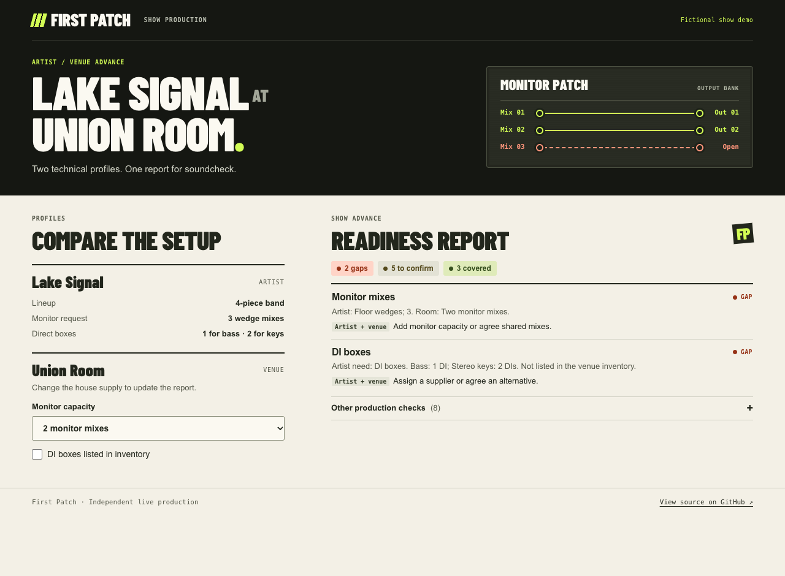

# First Patch

First Patch helps artists and venues agree on the technical setup before load-in. Compare a band’s stage requirements with a room’s equipment and get a show-day handoff with the evidence, next action, and owner for each finding.

**[Try the interactive show advance](https://abp2204.github.io/first-patch-showcase/)** · **[Watch the 18-second walkthrough](media/first-patch-walkthrough.mp4)**

[](https://abp2204.github.io/first-patch-showcase/)

## Try one change at a time

Lake Signal is a fictional four-piece band. The singer plays stereo keys, the bassist needs a direct box, and the band requests three independent stage monitor mixes. Union Room has two mixes and no direct boxes listed.

| Change to the venue profile | What the report tells the crew |
| --- | --- |
| Open the demo | The monitor supply falls one mix short. The artist and venue need to agree on a supplier for three direct boxes, one for bass and two for stereo keys. |
| Set monitor capacity to **3–4 monitor mixes** | The lower bound now covers the band’s request. The monitor finding clears and the DI supply gap stays open. |
| Select **DI boxes listed in inventory** | The venue owns the follow-up to confirm quantity, model and date availability. The report shows zero gaps and six items to confirm. |

Expand **Other production checks** for console inputs, PA, stage access, microphones and house limits. Reload to return to the original room.

## The engineering decision

Artists describe signal paths. Venues describe equipment, often in ranges or inventory checkboxes. Treating either as an exact channel list gives the crew false confidence. First Patch compares the answers they can give and keeps what is unknown visible.

1. **Normalize two profiles.** Conditional questionnaire rules select answers that apply to the act and the room. The artist’s connection choices can introduce needs even when a separate supply checkbox is empty.
2. **Match supply against demand.** The engine compares numeric ranges, derives the input estimate, and checks requested gear. Every finding is classified as covered, a gap, or a confirmation.
3. **Hand off the decision.** Every finding carries the evidence, action, and responsible party. Inventory presence can establish who should confirm supply while leaving quantity unresolved.

For the monitor case, a venue’s upper bound below demand is a gap. A lower bound that meets demand is covered. Uncertain capacity is a confirmation. The expanded checks also preserve questions that need a conversation, such as exact stage dimensions.

## Run and verify

Open `index.html` directly in a modern browser, or serve the directory locally with Python 3.

```sh
python3 -m http.server 8000 --bind 127.0.0.1
```

Visit `http://127.0.0.1:8000`. All rules, fixtures, styles and fonts load locally. Each control runs the matcher again against an in-memory venue profile. Refreshing resets the example. The demo works without credentials, installed packages, a database, or a network connection after download.

To run the regression checks with Node.js 20 or newer:

```sh
node --test tests/matching.test.cjs
```

The checks exercise the two initial gaps, capacity and inventory changes, responsibility for the remaining DI confirmation, and rejection of incomplete or swapped profiles.

## Source and scope

This public edition extracts the matching and questionnaire modules from Aayush Patel’s First Patch application at revision `b69b982ecf4c3c367605db59f0c95d4a2518d4c4`. The browser JavaScript was compiled from TypeScript with the original matching rules intact. The module wrappers expose the same functions to the browser and the tests.

- [Questionnaire definitions and derived technical facts](engine/questionnaires.js)
- [Matching rules and report structure](engine/matching.js)
- [Fictional band and venue profiles](fixtures.js)
- [Interactive report rendering](app.js)

The band, room and contact placeholders are synthetic. The original application also supports an operator workflow for collecting and storing profiles. This public edition demonstrates the comparison and handoff entirely on the client. All counts in the walkthrough come from the example profiles.

Barlow Condensed is bundled under the [SIL Open Font License](assets/Barlow-Condensed-OFL.txt).
